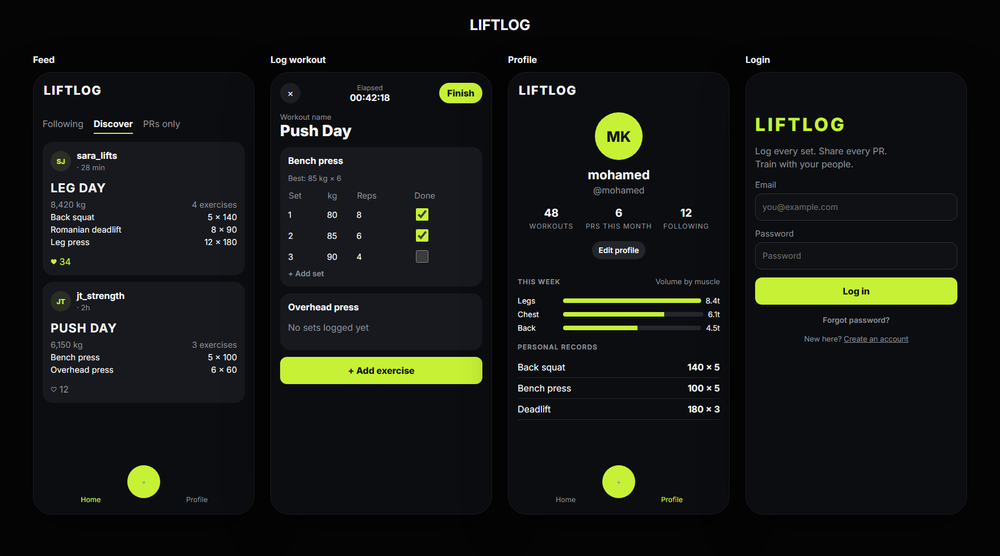

# Gym Social

A social workout log. Lifters record sessions set by set, follow each other, like workouts, and see where their lifts rank against other lifters and inside communities.



**Stack:** FastAPI, SQLAlchemy 2, PostgreSQL, Alembic, React (Vite), Docker, GitHub Actions, S3.

## Features

- Workouts with exercises and sets, visible to `public`, `followers`, or `private`
- Personal records flagged automatically, including when an older workout is edited or deleted
- Feed with following/discover scopes, exercise and muscle-group filters, and cursor pagination
- Strength rankings by estimated one-rep max per kilogram of bodyweight, overall and per community
- Profile with weekly volume by muscle group, PRs this month, and best lifts
- JWT auth with refresh token rotation, logout, and login rate limiting
- Workout photos on local disk in development and S3 in production

## Design decisions

**PRs are stored, not recalculated on read.** Flagging a set as a PR means comparing it with the lifter's whole history. Doing that on every feed request cost one query per exercise per workout, which grew with every page. Now `is_pr` is written when a workout is saved, and replayed for the touched exercises when one is edited or deleted. A feed page is a fixed number of queries whatever its size, and `test_feed_query_count_does_not_grow_with_page_size` keeps it that way.

**Rankings run in Postgres.** Each lifter's best estimated max, percentiles and ranks come from window functions (`rank()`, `count() OVER`) in one query, rather than loading every lifter into Python.

**Estimated one-rep max, not heaviest weight.** Ranking on the heaviest set meant 1 × 100 kg beat 10 × 95 kg. Sets are scored with the Epley formula (`weight × (1 + reps / 30)`) and divided by bodyweight.

**Cursor pagination.** The feed pages on `(performed_at, id)` instead of `OFFSET`, so new posts don't shift pages and deep pages are as cheap as the first.

**Database constraints instead of check-then-insert.** Likes, follows and community joins use `INSERT ... ON CONFLICT DO NOTHING`. Two taps at the same time used to race and return a 500; now one wins and the other gets a 409. There is a threaded test for this.

**Exercise catalogue.** Exercises were global and the first person to type a name set its muscle group for everyone. Common lifts now come from a seeded catalogue with fixed muscle groups, and anything else becomes the lifter's own custom exercise.

**Refresh tokens are single use.** Each refresh issues a new pair and revokes the old token. If a revoked token is used again, it was copied, so all of that user's sessions are revoked.

**Stateless containers.** Photos go to S3 when `S3_BUCKET` is set, the rate limiter can share state through Redis, and migrations run as a separate one-off step, so the API can run as several replicas.

## Layout

```
app/
  core/        settings, auth tokens, logging, rate limiting
  db/          engine and session
  models/      tables
  schemas/     request and response models
  routers/     HTTP routes, kept thin
  services/    queries and business logic
alembic/       migrations
frontend/      React app
deploy/        nginx and systemd config for the VPS
tests/
```

## Run locally

Copy `.env.example` to `.env`, set `SECRET_KEY` (`openssl rand -hex 32`), and point it at Postgres.

```bash
docker compose -f docker-compose.dev.yaml up --build
```

Or, with Postgres already running:

```bash
pip install -r requirements-dev.txt
alembic upgrade head
uvicorn app.main:app --reload
```

The API lives under `/api/v1`. Interactive docs are at http://localhost:8000/api/v1/docs and `GET /health` returns `{"status": "ok"}`.

```bash
cd frontend
npm install
npm run dev
```

Open http://localhost:5173.

## API

| Method | Path | |
| --- | --- | --- |
| `POST` | `/users/` | Register with `email`, `username`, `password`, `bodyweight_kg`, `height_cm` |
| `POST` | `/login` | Form fields `username` (or email) and `password`; returns access and refresh tokens |
| `POST` | `/refresh` | `{"refresh_token": ...}`; returns a new pair, the old token stops working |
| `POST` | `/logout` | `{"refresh_token": ...}` |
| `GET`, `PATCH` | `/users/me` | Read or update username, bodyweight, height |
| `GET` | `/users/me/profile?tz=Europe/London` | Weekly volume, records, rankings |
| `POST`, `DELETE` | `/users/{id}/follow` | |
| `POST` | `/workouts/` | Create a workout (body below) |
| `GET`, `PATCH`, `DELETE` | `/workouts/{id}` | |
| `POST` | `/workouts/{id}/photo` | JPEG, PNG or WebP, up to 5 MB |
| `POST`, `DELETE` | `/workouts/{id}/like` | |
| `GET` | `/feed/` | `scope`, `exercise`, `muscle_group`, `performed_from`, `performed_to`, `limit`, `cursor` |
| `GET`, `POST` | `/communities/` | |
| `POST`, `DELETE` | `/communities/{slug}/join` | |

```json
{
  "notes": "easy session",
  "performed_at": "2026-10-18T09:00:00Z",
  "visibility": "public",
  "exercises": [
    {"name": "Bench press", "muscle_group": "chest", "sets": [{"reps": 8, "weight": 80}]}
  ]
}
```

`muscle_group` is one of `chest`, `back`, `shoulders`, `arms`, `legs`, `core`, `full_body`. Common names like `quads` or `lats` are mapped for you.

The feed returns `{"items": [...], "next_cursor": "..."}`. Pass `next_cursor` back as `cursor` for the next page; it is `null` on the last one.

## Deploy

**Docker:** `docker compose -f docker-compose.prod.yaml up -d` starts Postgres, Redis, a one-off migration job, then the API. Set `DATABASE_PASSWORD`, `SECRET_KEY`, `CORS_ORIGINS`, and `S3_BUCKET` to store photos in S3. The container runs as a non-root user with gunicorn managing uvicorn workers (`WEB_CONCURRENCY`).

**VPS:** every push to `main` that passes CI deploys automatically. The `deploy` job SSHes into the server and runs `deploy/deploy.sh`, which pulls `main`, installs dependencies, updates the systemd unit and nginx config, restarts (migrations run first via `deploy/gunicorn.service`), and fails the job if `/health` doesn't come back. One-off setup:

1. Make a deploy key on your computer: `ssh-keygen -t ed25519 -f gym-social-deploy -N ""`, and add `gym-social-deploy.pub` to `~/.ssh/authorized_keys` on the server.
2. Get the server's host key: `ssh-keyscan 178.128.32.16`.
3. In GitHub → Settings → Secrets and variables → Actions, add secrets `DEPLOY_SSH_KEY` (contents of `gym-social-deploy`), `DEPLOY_KNOWN_HOSTS` (the ssh-keyscan output), `DEPLOY_HOST` (`178.128.32.16`), `DEPLOY_USER` (`root`), and the variable `DEPLOY_ENABLED` = `true`.

The script can also be run by hand on the server: `sudo bash deploy/deploy.sh`.

## Tests

```bash
python -m ruff check app tests
python -m ruff format --check app tests
python -m pytest
```

Tests need Postgres and use a database ending in `_test`. The schema is built by running the real migrations, and each test runs in a transaction that is rolled back, so tests are isolated without rebuilding the schema. CI also checks that migrations upgrade, downgrade and match the models (`alembic check`).
